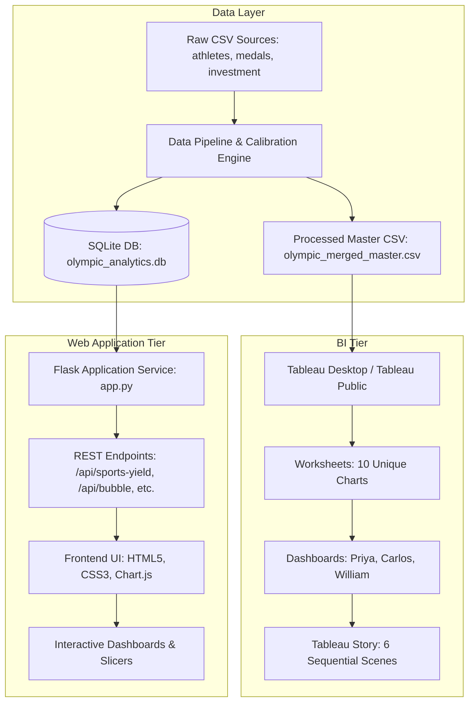

# Technical Architecture Document
## Global Olympic Sports Performance Analysis (1992 – 2026)

---

## 1. System Topology & Component Interactions



---

## 2. Relational Database Schema Specification

### 2.1 Entity Relationship Model
- `athletes` (1) ───< `medal_results` (N)
- `countries` (1) ───< `country_sports_investment` (N)
- `hosts` (1) ───< `host_performance` (N)
- `regions` (1) ───< `regional_efficiency` (N)

### 2.2 Database Indexes
```sql
CREATE INDEX idx_medals_year ON medal_results(Year);
CREATE INDEX idx_medals_country ON medal_results(Country_Code);
CREATE INDEX idx_medals_sport ON medal_results(Sport_Category);
CREATE INDEX idx_athletes_sport ON athletes(Sport_Category);
```

---

## 3. REST API Contract

| Endpoint | Method | Response Payload | Cache TTL |
|---|---|---|---|
| `/api/kpis` | GET | Global metrics: total medals, athletes, superpowers | 600s |
| `/api/sports-yield` | GET | Sport category medal yield array (Rowing: 6.916, Shooting: 6.731) | 600s |
| `/api/global-performance` | GET | Stacked medal totals per country (USA: 735, CHN: 696) | 600s |
| `/api/investment-bubble` | GET | Country investment vs medals array with overperformer flags | 600s |
| `/api/regional-efficiency` | GET | Regional efficiency percentages (South America: 49.64%, Europe/Asia: 45.98%) | 600s |
| `/api/yearly-trend` | GET | Yearly medal totals (2000: 305, 2020: 363, 2026: 334) | 600s |
| `/api/host-comparison` | GET | Host nation vs away average medals (Japan: 105, USA: 100, CHN: 93) | 600s |
| `/api/filter-data` | POST | Filtered master view records matching JSON filter criteria | None (Dynamic) |

---

## 4. Tableau XML Workbook Structure
The Tableau workbook (`Global_Olympic_Sports_Performance_Analysis.twb`) contains:
- `<datasources>`: Federated textscan connection referencing `olympic_merged_master.csv`.
- `<worksheets>`: 10 unique worksheets defining visual mark types, encodings, and dimension shelves.
- `<dashboards>`: 3 responsive grid dashboards configured with 1400x900 resolution.
- `<stories>`: 1 story containing 6 `<story-point>` nodes with narrative descriptions and associated dashboard views.
